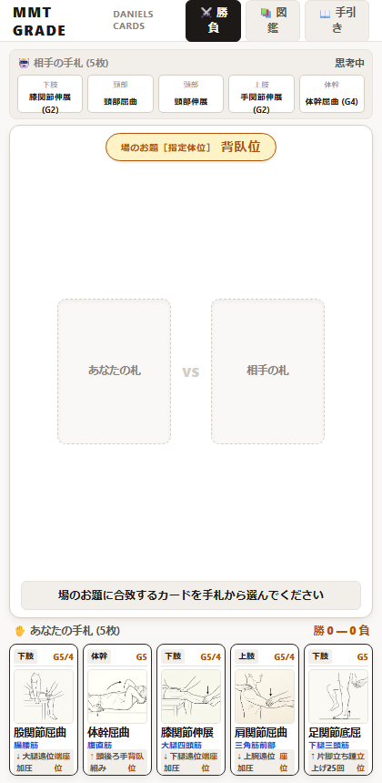

# MMT GRADE — ダニエルズ臨床カードバトル —

ダニエルズ徒手筋力検査法（MMT）の測定肢位・主動作筋・力学ベクトルを直感的にマスターできる、カルタ・オセロ式カードゲームWebアプリケーションです。



---

## 🎮 ゲーム概要

理学療法士・作業療法士の学生が、実習や国家試験で必須となる「徒手筋力検査法（MMT）」の姿勢と判定基準を、カルタ感覚で楽しく学べるゲームです。

- **場のお題（指定体位）**: 背臥位、腹臥位、端座位、側臥位などの指定肢位がターンごとに提示されます。
- **手札から出札**: 自分の手札5枚の中から、お題に合致するカードを素早く選択してバトル。
- **肢位マスター図鑑**: 全15動作の標準測定肢位、主動作筋、臨床力学ベクトルを網羅した閲覧モードを搭載。

---

## 🌟 特徴

1. **臨床に忠実な高精度線画**:
   - ダニエルズ原典に基づく正確な肢位（完全側臥位、前腕中間位、端座位など）を視覚化。
   - 骨や深層筋の透視ノイズを排除し、生身の臨床姿勢を明確に表現。
2. **上質なエディトリアルUI（Warm Bone）**:
   - 目に優しく清潔感のある生成り・ベージュ系（`#F9F8F6`）をベースにしたミニマリストデザイン。
   - スプリング物理アニメーションによる心地よいカード操作触感。
3. **1画面完全収容（スクロールゼロ）**:
   - スマホ縦画面（モバイルファースト）でスクロールなしで完結する設計。

---

## 🚀 起動方法

依存パッケージなし（Vanilla HTML/CSS/JS）で動作します。

```bash
# 任意の静的サーバーで起動
python -m http.server 8080
# または
npx serve .
```

ブラウザで `http://localhost:8080` を開くだけで即座にプレイできます。

---

## 📁 ディレクトリ構成

```text
├── index.html        # メインUI（勝負 / 図鑑 / 手引き）
├── style.css         # Warm Boneデザインシステム・カード物理CSS
├── app.js            # ゲームエンジン・CPU対戦ロジック・図鑑描画
├── data/
│   └── cards.json    # 全15動作の臨床カードマスターデータ
├── assets/
│   ├── cards/        # 各MMTカードの臨床線画アセット
│   └── *.png         # プレビュー画像
├── harness/          # 臨床整合性＆幾何視覚独立監査ハーネス
└── scripts/          # 自律周回・品質検証スクリプト
```

---

## 📜 ライセンス

MIT License
